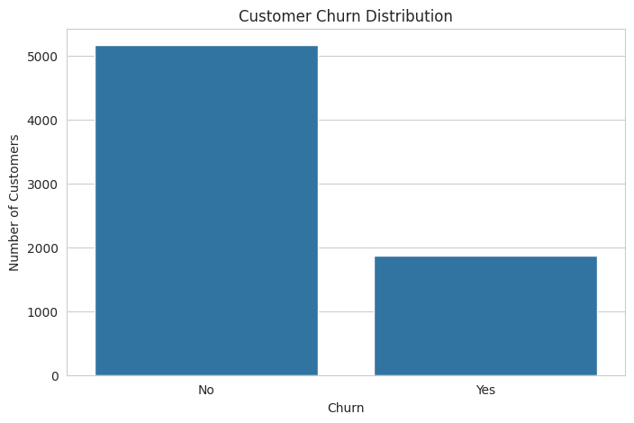
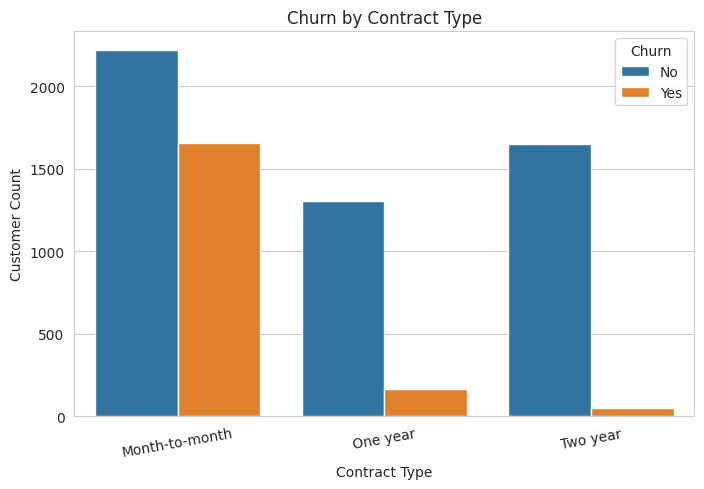
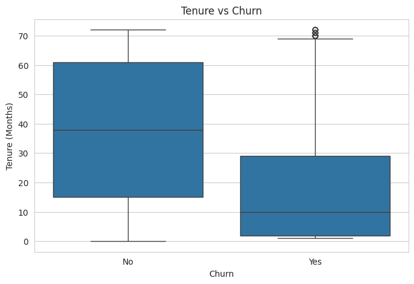
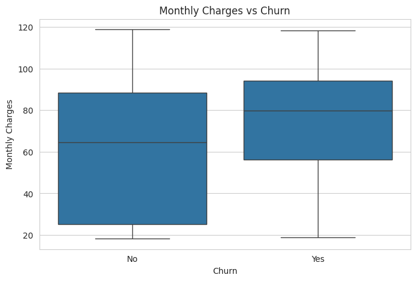

# Customer Churn Analysis & Prediction

An end-to-end exploratory data analysis (EDA) and machine learning classification project built to identify at-risk telecom customers and uncover the primary drivers behind customer attrition.

🔗 **Live Project Portfolio:** [View GitHub Pages Site](https://nuthigauri21.github.io/customer-churn-analysis-and-prediction/)

---

## 📌 Project Overview
Customer retention is critical for subscription-based businesses. Using the Telco Customer Churn dataset (7,043 customer records), this project walks through data cleaning, exploratory data analysis, feature encoding, classification modeling, and model evaluation to predict whether a customer is likely to churn.

---

## 🛠️ Tech Stack
* **Language:** Python
* **Data Manipulation & Analysis:** Pandas, NumPy
* **Data Visualization:** Matplotlib, Seaborn
* **Machine Learning & Evaluation:** Scikit-Learn (Logistic Regression, Random Forest, Confusion Matrix, ROC-AUC, Precision, Recall, F1-Score)

---

## 🔍 Methodology & Workflow
1. **Data Preparation & Cleaning:**
   * Inspected 7,043 customer records across 21 features.
   * Cleaned blank entries in `TotalCharges`, converted the column to numeric format, and imputed missing values using the median.
   * Removed non-predictive identifiers (`customerID`) and encoded categorical variables using `LabelEncoder`.
   * Split the dataset into stratified training (80%) and testing (20%) sets.
2. **Exploratory Data Analysis (EDA):**
   * Analyzed overall class distribution (73.5% retained vs. 26.5% churned).
   * Evaluated attrition patterns across tenure, contract type, monthly charges, payment method, and demographic attributes.
3. **Classification Modeling & Evaluation:**
   * Trained and compared **Logistic Regression** (baseline linear classifier) and **Random Forest** (`n_estimators=200`, `max_depth=10`).
   * Achieved **~80% classification accuracy** and evaluated performance using **Precision, Recall, F1-score, Confusion Matrix, and ROC-AUC**.

---

## 💡 Key Churn Drivers Identified
* **Customer Tenure:** Customers in their early months with the company exhibit significantly higher churn rates than long-term subscribers.
* **Contract Type:** Month-to-month contract holders churn at a much higher rate compared to customers on one-year or two-year contracts.
* **Monthly Charges:** Higher monthly billing amounts strongly correlate with increased customer attrition, particularly among short-tenure users.

---

## 📊 Visualizations

| Overall Churn Distribution | Churn by Contract Type |
| :---: | :---: |
|  |  |

| Tenure vs. Churn | Monthly Charges vs. Churn |
| :---: | :---: |
|  |  |

---

## 📂 Repository Structure
```text
├── images/                         # Saved EDA visualizations
│   ├── churn_distribution.png
│   ├── churn_by_contract.png
│   ├── tenure_vs_churn.png
│   └── monthly_charges_vs_churn.png
├── index.html                      # GitHub Pages portfolio webpage
├── saiket.ipynb                    # Complete Jupyter Notebook (EDA + ML models)
└── README.md                       # Project documentation
